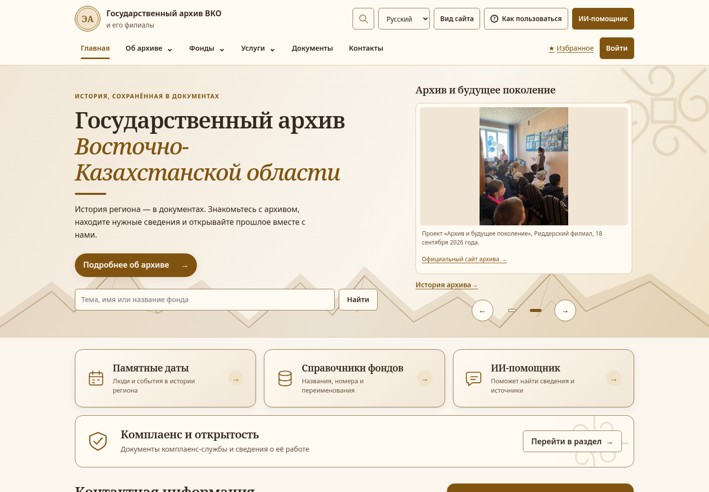

# ALEteam — электронный архив Восточного Казахстана

**Современный сайт государственного архива: поиск по реальным источникам, чтение оригиналов и собственный ИИ-помощник.** Проект создан для хакатона как обновление [сайта архива ВКО](http://e-arhiv.vko.gov.kz/ru).

**[Открыть демо](https://ale-archive-preview-qwir3qwmza-ew.a.run.app/)** · **[Результаты финальной проверки](docs/final-integration-20261112/README.md)** · **[Собственная модель: обучение и веса](training/README.md)**

Финальная сборка находится в **`main`**. Опубликованный стенд обновляется отдельно; доказательства ниже относятся к проверенной локальной production-сборке и Docker-образу.



## Какую задачу решаем

Архивные сведения должны быть доступны человеку, который не знает точного шифра документа или исторического названия города. ALEteam объединяет материалы сайта, справочники фондов и газет, оригиналы документов и помощь в поиске в одном интерфейсе. Посетитель может проверить ответ по источнику и прочитать сам документ.

## Что реализовано

| Возможность | Что получает посетитель |
| --- | --- |
| Поиск по архиву | Общая выдача материалов, фондов и газет, фильтры и поиск по реквизитам. «Өскемен», «Оскемен», «Усть-Каменогорск» и «Усть Каменогорск» дают одинаковые результаты. |
| Собственный ИИ-помощник | Короткий диалог о сайте, помощь с запросом, ответы с цитатами и переходами к доступным источникам. |
| Оригиналы документов | Просмотр и скачивание PDF, чтение DOCX до последнего фрагмента. Полный официальный прейскурант — 15 страниц. |
| Три языка | Интерфейс на русском, казахском и английском. Если перевода материала нет, доступен опубликованный оригинал с обозначением языка. |
| Личный кабинет | Публичная регистрация, вход, избранное, подписки на темы и уведомления в кабинете. |
| Обсуждения | Комментарии с локальным фильтром нецензурной лексики, модерацией и ограничением частоты запросов. |
| Работа сотрудников | CMS, роли и права, редакционное согласование, публикация и отзыв материалов. Закрытые материалы исключаются из публичного доступа и ответов помощника. |
| Доступный интерфейс | Адаптивные страницы, светлая и тёмная темы, увеличение текста, состояния загрузки и понятные ошибки. |

**Реальное наполнение:** 53 языковые редакции материалов, 13 филиалов, 1 705 фондовых групп, 1 466 газетных строк и 44 оригинала/превью. Это разные типы записей: строка справочника не означает наличие оцифрованного дела. Исходные материалы и сведения об их происхождении находятся в [sources](sources/).

## Собственный ИИ: что именно обучено

Команда обучила **небольшую авторегрессионную нейросеть с нуля**, со случайной инициализацией, без предобученных весов и внешнего LLM API. Архитектура: собственное кодирование символьных n-грамм, энкодер и рекуррентный декодер; **115 073 обучаемых параметра**. Обучение выполнено на Python/PyTorch, инференс — локально на TypeScript.

Модель преобразует поддерживаемые формулировки в поисковые запросы. Помощник объединяет её с правилами, поиском и проверкой доступа, затем собирает ответ из цитат опубликованных источников. Это специализированная модель для архивного поиска, а не универсальная LLM. API-ключ для основного режима не нужен.

[Код обучения](training/train.py) · [Веса](training/models/query-model.json) · [Данные и отчёт](training/README.md) · [Диалог о сайте](training/DIALOG.md)

## Что показать жюри за две минуты

1. **Главная:** фотографии реального архива, смена языка и темы; открыть контакты или историю архива.
2. **Поиск:** ввести «Өскемен», затем «Усть-Каменогорск» и сравнить выдачу. В проверенном корпусе — по 1 048 результатов.
3. **Оригиналы:** открыть «Историю архива», дочитать документ кнопкой «Читать дальше». В разделе платных услуг открыть PDF и перейти на страницы 2 и 15.
4. **Помощник:** зарегистрироваться, открыть ИИ и спросить «Когда был создан архив?». Проверить цитату о 1940 годе и перейти к источнику. Затем попробовать короткий запрос «Оскемен».

## Как запустить

**На своём компьютере:** нужны Git, Node.js 24 и Docker с Compose v2. Из корня репозитория:

```bash
npm run deploy:setup
docker compose --env-file deploy/.env -f deploy/compose.yaml up -d --build --wait app
```

Открыть **http://localhost:3100** на том же компьютере. Приложение, база и файловое хранилище запускаются в Docker; `npm ci` на компьютере не требуется. Настройка сохраняет существующий `deploy/.env`; секреты в Git не добавляются. [Подробности запуска и резервных копий](deploy/README.md).

**Обновить существующий сайт в Cloud Run:** в авторизованном Cloud Shell из корня репозитория:

```bash
git fetch origin && git switch main && git pull --ff-only origin main && bash deploy/cloud-run/update.sh
```

Скрипт обновляет `ale-archive-preview`, сохраняет подключённую БД и настройки входа и проверяет публичные файлы после публикации. [Инструкция Cloud Run](deploy/cloud-run/README.md).

## Что проверено

Финальная приёмка выполнена на production-сборке и компактном Docker-образе:

- **404 модульных и 22 HTTP-теста**, TypeScript и 1 060 ключей переводов — без ошибок.
- **69 публичных страниц на RU/KK/EN**, регистрация и вход, фотографии, ссылки ИИ и индикатор перехода.
- **44 файла** скачаны и сверены по SHA-256; PDF проверен на страницах **2 и 15**, DOCX — до последнего фрагмента.
- Первый запуск в пустой тестовой БД и обновление существующей: полный PDF прикрепляется, повтор не создаёт дублей; аккаунты и сессия сохраняются.

[Полная сводка](docs/final-integration-20261112/validation.json) · [Сценарии и скриншоты](docs/final-integration-20261112/README.md) · [Реальные ответы помощника](docs/final-integration-20261112/main-path.json)

**Границы прототипа:** новые пользовательские загрузки в Cloud Run требуют отдельного постоянного файлового хранилища; почтовая доставка и сброс пароля по email ещё не подключены. Перенесён проверенный корпус источников, а не все исторические публикации старого сайта. Локальные проверки не подменяют проверку публичного стенда после развёртывания.

## Команда и технологии

- **Алимжан** — серверная часть, API, доступ к данным и финальная интеграция.
- **Алинур** — фронтенд, адаптивный дизайн и пользовательские сценарии.
- **Артур** — ИИ-модули, обработка источников и новые возможности поиска.

**Стек:** Next.js, React, TypeScript, PostgreSQL, Prisma, Better Auth, Python/PyTorch, Docker; развёртывание — Google Cloud Run.

Для технического разбора: [архитектура](docs/ARCHITECTURE.md), [API](docs/API.md), [CMS и роли](docs/cms/API.md), [операции с реальным корпусом](docs/real-content/OPERATIONS.md).
