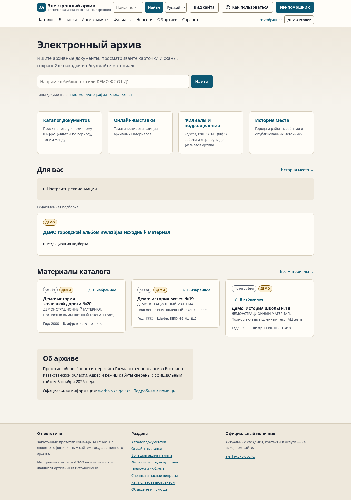
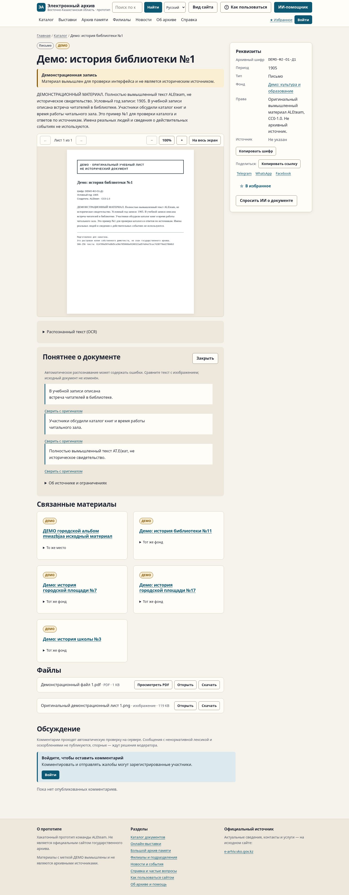
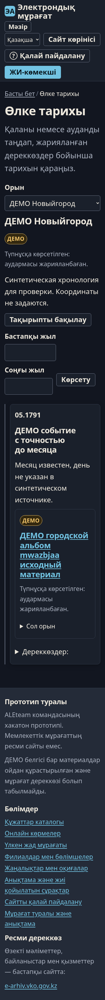
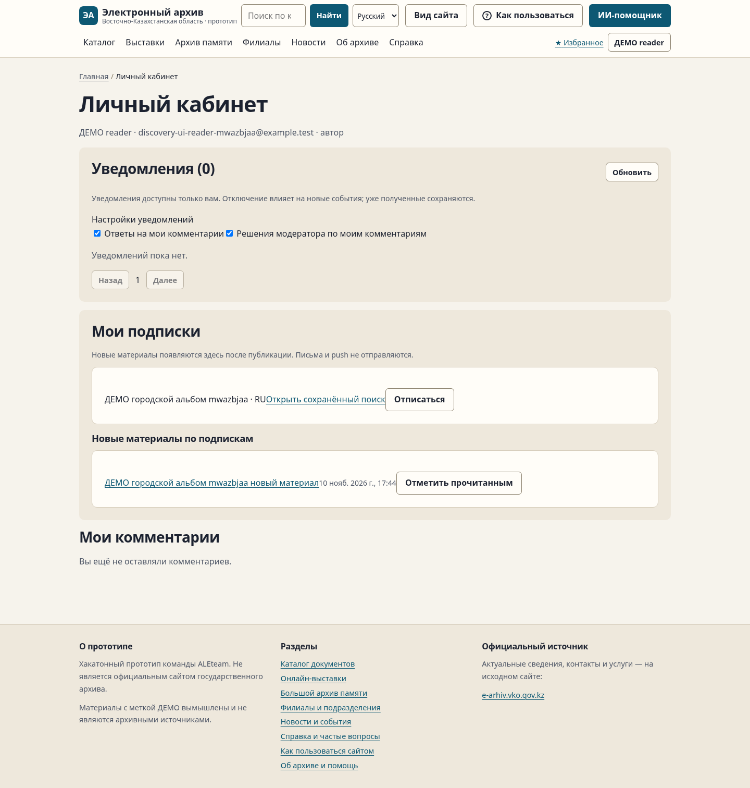

# Проверка общей интеграции Артура

Код: `c6a17d197e630a6415454216ddb9675050c0b7ea`; реальные API/production Next.js/отдельная PostgreSQL `_test`, Chromium. Снимки и видео показывают синтетические ДЕМО-материалы, не утверждённые исторические документы. Секретные env/БД/backup/серверные логи в Git не копировались.

| Проверка | Результат |
|---|---|
| Модульные |359/359|
| HTTP исходной общей регрессии |139/139,8 наборов|
| Изменённые API + общий UI |[полный финальный запуск](full-final-runner-summary.json), [последняя перепроверка](runner-summary.json)|
| Планировщик по источникам |26/26,0 точных train/validation совпадений; не нейросетевая точность|
| Релизный браузер |13/13,54 экрана,0 нарушений axe|
| Настройки чтения |28 проверок,24 сочетания ширины/темы/размера|
| Общий UI Алинура после интеграции |70/70,125 проходов страниц×вариантов,0 page errors|
| Сквозной путь новых функций |10/10,включая master/preview и язык подписки|
| Геометрия и доступность |102 измерения,0 замечаний|
| Docker/перезапуск/backup/restore |21/21,оба образа одной версии|

[Все SHA и границы проверки](host-summary.json) · [исходники/пробелы](../SOURCE-REVIEW.md) · [сценарий и воспроизведение](../DEMO.md).

## Lighthouse13.6.0

По одному локальному замеру каждого сочетания. Стандартное simulated throttling инструмента; параметры и размер синтетического корпуса — [в JSON](performance-summary.json). Это не SLA публичного сервера.

| Экран | Mobile performance | Desktop performance | Accessibility |
|---|---:|---:|---:|
|Главная|[89](performance/home-mobile.report.html)|[100](performance/home-desktop.report.html)|100/100|
|Каталог|[95](performance/catalog-mobile.report.html)|[100](performance/catalog-desktop.report.html)|100/100|
|Карточка|[100](performance/document-mobile.report.html)|[100](performance/document-desktop.report.html)|100/100|

## Видео и снимки

[Настоящая запись браузерного сценария (MP4, без аудио)](walkthrough.mp4). Все действия выполняются через настоящие страницы/API; публикации проверяют разные тестовые аккаунты. Это автоматический показ, а не состоявшаяся командная защита.

### Главная

### Документ и цельные цитаты

### История места,360px/150%,тёмная тема/KK

### Подписки и новое уведомление

[Остальные снимки](screenshots) включают помощь/тур/настройки/крупный текст/EN и эмуляцию200% (не физический browser zoom). Вручную просмотрены основные снимки главной, документа и мобильной хронологии; ручная приёмка скринридером/носителями языков не проводилась.
