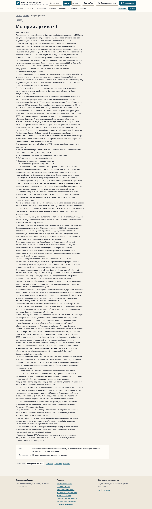
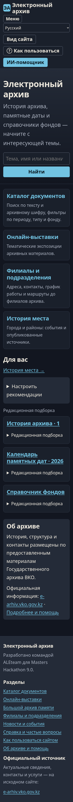

# Реальное содержание: скриншоты и проверки

11 ноября 2026. [Состав и границы результата](../STATUS.md). Снимки сняты на свежем обычном наполнении из присланных источников. Это текущий интерфейс; новый визуальный этап Алинура ещё не принят.

История архива, настольный экран:

Та же история, мобильный экран, тёмная тема и текст 150%:

Главная с настоящими источниковыми рекомендациями:

[Запись браузерного просмотра](real-content.webm) · [сценарии и SHA проверяемого кода](report.json) · [Docker и восстановление](docker.json).

В report.json сохранены результаты 36 сочетаний размеров/языков/тем/размера текста. Учётные записи технические, из отдельной тестовой базы. Пароли и резервные копии в эту папку не включены. Docker-отчёт относится к интегрированному корпусу до последних уточнений тем/вопроса о дате; точный SHA итогового Node-прогона указан в report.json.
