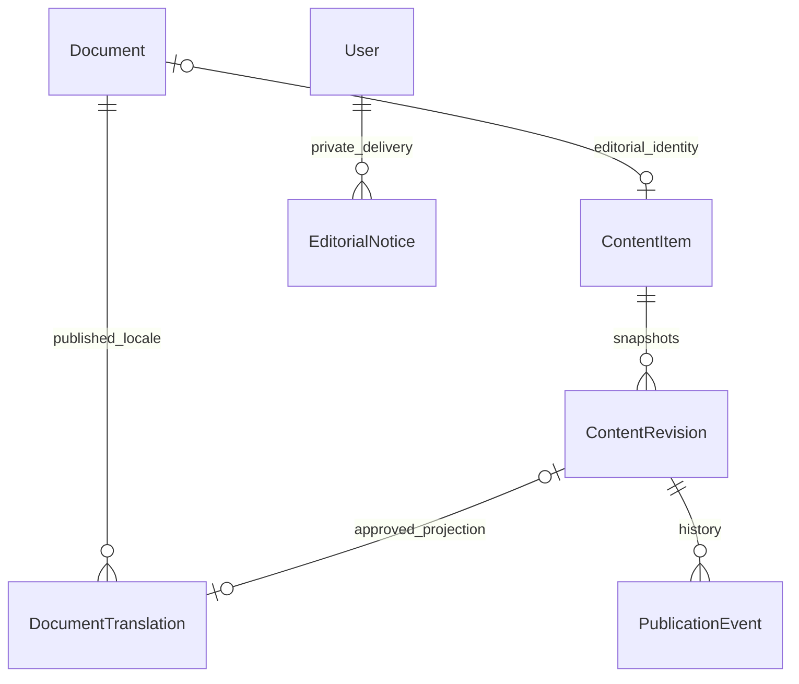

# Каталог: снимки и публичные проекции

Дополнение к [схеме CMS](../cms/ARCHITECTURE.md). Миграция `202611090004_catalog_workflow` не меняет старые миграции/ID/связи. Новые поля: timestamps иерархии, Document.updatedAt/deletedAt/contentItemId/category/tags/sourceNote/catalogVersion, ContentRevision.catalogBaseVersion и DocumentTranslation. Сохраняется собственный журнал SQL-миграций; новый enum не используется до завершения транзакции миграции.

Архивный ContentItem имеет внутренний тип ARCHIVE_DOCUMENT, недоступный в общей информационной CMS. Его slug находится в зарезервированном пространстве _archive-, которое нельзя занять через публичную схему информационных материалов; каталог не зависит от занятости публичного URL. Права каталогового чтения/записи отделены от content.read/write; проверяющий/публикующий дополнительно должен читать каталог. Существующие версии, события, уведомления и проверка сотрудника переиспользуются. Это не вторая независимая система согласования.

Редакции хранят полный снимок в JSON с отдельной строгой схемой. Приватные заметки вообще не входят в него. Document хранит текущую основную проекцию, используемую существующими комментариями, файлами, избранным и собственным ИИ. DocumentTranslation хранит только утверждённые переводимые поля языка, ссылается на исходную ContentRevision; старые утверждённые данные мигрируют с nullable revisionId, без вымышленного автора/проверяющего. Триггеры не публикуют черновики. Seed дополняет только старые демопроекции и не управляемые редакции.

На публикации RU атомарно проверяются источник/права/принадлежность дела фонду/версия, меняются Document и RU-проекция, архивируется прежняя RU-редакция, устаревшие переводы снимаются/возвращаются на проверку и создаются события/уведомления. catalogVersion связывает перевод с источником. Публикация KK/EN не меняет структурные поля и RU. Снятие RU закрывает бинарный доступ во всех языках. Текущий собственный ИИ читает только основную опубликованную проекцию; изучение новых тем/полноценный трёхъязычный корпус — Артур.

Для прототипа все изменения/публикации каталога сериализуются одним PostgreSQL advisory transaction lock 782032102. Порядок: catalog lock → блокировки редакции → изменение/события. Это исключает гонку между проверкой родительских связей и их удалением/правкой. Чтения не блокируются этим lock. Сужение блокировки/нагрузка — TZ-B12 после замеров, производительность на реальном объёме не заявляется.

Иерархия не переносится произвольной заменой parent ID. Правки/удаления ограничены фондом без публичных/проверяемых карточек, SQL FK запрещают потерю детей. Документы удаляются в корзину, сохраняя связи/историю, и восстанавливаются закрытыми. Даже архивный/удалённый ребёнок удерживает родительскую связь — импорт/переклассификация требуют отдельного процесса TZ-B08.

Публичный поиск читает только isPublic=true, deletedAt=null и выбранный DocumentTranslation; PK(documentId,locale) исключает дубли. Новые GIN-индексы простого/русского FTS создаются на generated tsvector проекций, отдельные индексы добавлены на caseId/originalLanguage и номера. Параметры не превращаются в SQL-идентификаторы/фрагменты. Счётчик/страница — один RepeatableRead snapshot. private notes и черновики не входят ни в индексы переводов, ни в публичные SELECT.

Решение о RU как основном языке и консервативная блокировка всего фонда документированы в [API](API.md), остаются технической политикой до TZ-A02. Имена архивных узлов не переводятся автоматически. Новых официальных данных, пользовательской геолокации, аналитики и внешних LLM нет.
