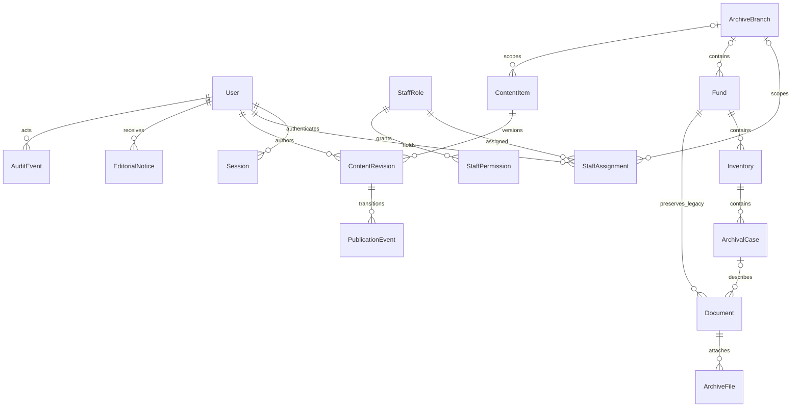

# CMS: первый серверный этап, 9 ноября 2026

Реализация TZ-B01/B02/B03/B05/B06/B09 в ветке `backend/alimzhan-cms-foundation`. Это техническая основа, а не заявление о полном выполнении ТЗ. Статус каждого пункта — в [очереди Алимжана](../../задачи/ТЗ-2026-11-09/Алимжан.md).

Сохраняем Next.js, PostgreSQL 16, Prisma и Better Auth: для прототипа достаточно одной транзакционной БД. Права не зависят от скрытия кнопок. Отдельный поисковый сервер и микросервисы сейчас не нужны: сначала измерения TZ-B12. [Контракты TypeScript](../../src/contracts/cms.ts), [API](API.md), [политика-пресет](POLICY-DRAFT.md).

## Миграция и совместимость

Миграция `202611090003_cms_foundation` добавляет таблицы и поля. Старые документы/фонды не привязываются к вымышленному филиалу/описи/делу: новые связи nullable. Семь пресетов добавляются без назначения существующим пользователям; AUTHOR/MODERATOR остаются ролями комментариев. Старые открытые документы сохраняют доступ к цифровым копиям; новые карточки создаются закрытыми.

Составные FK `дело→(опись,фонд)` и `документ→(дело,фонд)` запрещают смешивать фонды. Номера — строки: `0007` сохраняется. Отдельное `originalLanguage` не зависит от языка интерфейса. `internalNotes` исключены из публичной проекции; `allowDigitalCopy=false` закрывает метаданные файлов, байты и OCR.

Миграции применяются только `npm run db:migrate`: существующий собственный журнал с хешами и advisory lock. Старые SQL не редактируются; `db push` и второй журнал Prisma не используются. Перед обновлением общей БД — частная резервная копия; развёртывание и откат — [действующий регламент](../DEPLOYMENT.md). Новые сущности входят в полный PostgreSQL dump, автоматическое восстановление CMS проверено в Docker; независимая приёмка TZ-B11/B13 остаётся.

## Редакция и публикация

Каждая языковая редакция независима. Черновик меняется с `expectedUpdatedAt`; конфликт возвращает 409. Блокировки строк сериализуют конкурирующие правки/публикации, частичный уникальный индекс разрешает одну PUBLISHED-версию материала на язык. Новая публикация архивирует предыдущую версию в той же транзакции. Самоутверждение запрещено, правка сбрасывает проверяющего. Причины решений приватны; аудит содержит только идентификаторы, действие, автора и дату.

CMS-публикация не превращает закрытый каталог/файл в открытый: ссылки проверяются перед публикацией и повторно фильтруются при публичной выдаче. Скрытый профиль филиала исключается и из связанных материалов. Неизвестный перевод даёт 404, а не черновик или незаметный другой язык. Существующий ИИ пока читает старый публичный корпус: подключение CMS — TZ-A06 Артура.

## Хранилище и карты

Текущие файлы остаются вне `public`, в приватном volume, выдача через проверяющий API. Для TZ-B07 планируется отдельная запись неизменного мастера с SHA-256, карантином и отдельными превью/заданиями; загрузка, антивирус, TIFF и видео в этом этапе не реализованы. Секреты любых будущих интеграций хранятся в окружении/хранилище секретов, не в SETTING.payload.

Для карты предлагается Leaflet с OpenStreetMap и обязательной атрибуцией; подключение — TZ-F07 Алинура. До согласования провайдера, лимитов, политики внешних запросов и координат заказчика API отдаёт только проверяемые координаты опубликованного профиля. Бэкенд не обращается к картографическому сервису. Геолокация пользователя не собирается; построение маршрута требует отдельного согласия/действия в интерфейсе. Это выбор для дальнейшей интеграции, работающая карта ещё не заявляется.
