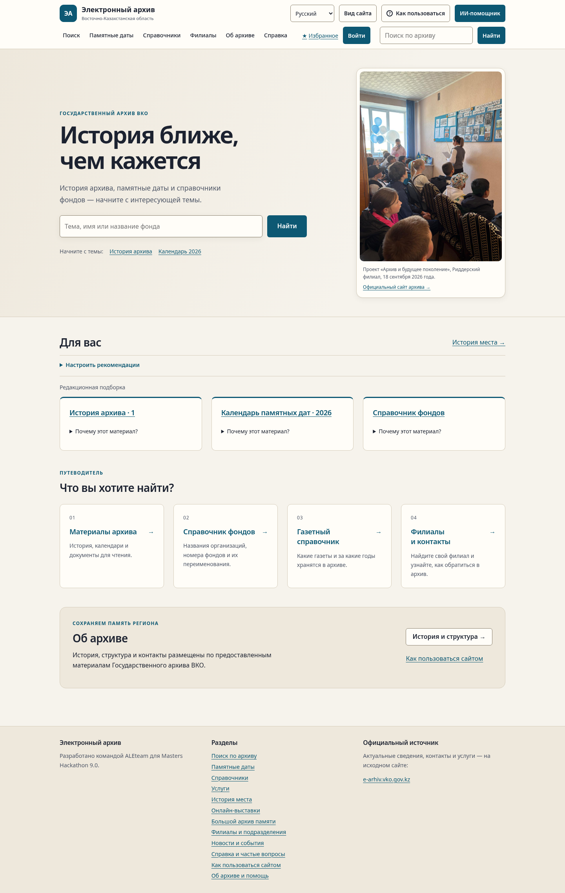
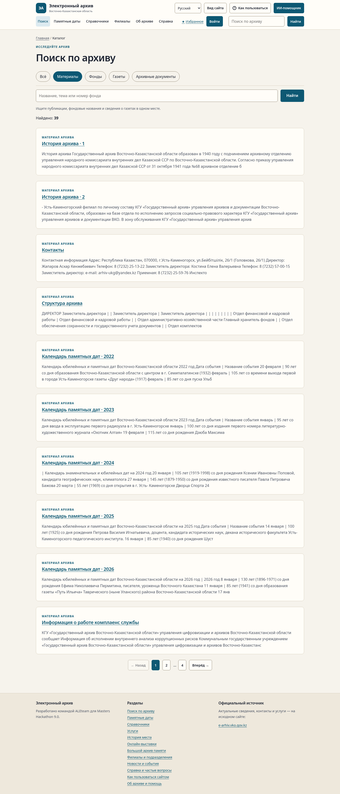
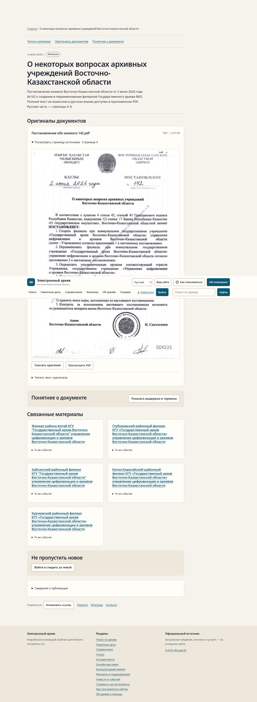
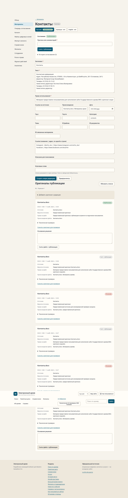

# Проверка нового интерфейса на реальном содержании

[Итог и границы этапа](../STATUS.md). Изображения сделаны после загрузки настоящих рекомендаций/справочников и шрифтов, без макетов и фиктивных карточек. Шрифты, тема, крупный текст и оригиналы работают на production-сборке.

Главная, светлая тема:

[Главная в тёмной теме](home-desktop-dark.png) · [Мобильная, тёмная тема, текст 150%](home-mobile-dark-150.png) · [Настоящий browser zoom 200%](home-zoom200.png).

Общий поиск:

[Фондовый справочник с буквальным номером](funds-desktop.png) · [тот же справочник, мобильный экран 150%](funds-mobile-dark-150.png).

Подлинное постановление и его страница 4:

[История архива и оригинал DOCX](material-desktop.png) · [история, мобильный экран 150%](material-mobile-dark-150.png) · [история места с источниковыми событиями](place-history.png).

Админка: оригинал после независимой проверки:

[Та же форма, мобильный экран 150%](cms-original-mobile-150.png).

[Видео пользовательских путей](walkthrough.webm) · [10 сценариев / 432 компоновки](ui.json) · [54 варианта настоящего browser zoom](browser-zoom.json) · [7 проверок админки](cms-admin.json) · [Lighthouse](performance.json) · [Docker и восстановление](docker.json).

Секреты, учётные данные, приватные профили браузера и резервные копии сюда не включены. Старые галереи остаются историей; текущая показана здесь.

[Услуги с новым полным фото читального зала](services-desktop.png) · [Календарь](calendar-desktop.png) · [Об архиве](about-desktop.png) · [Комплаенс](compliance-desktop.png).
