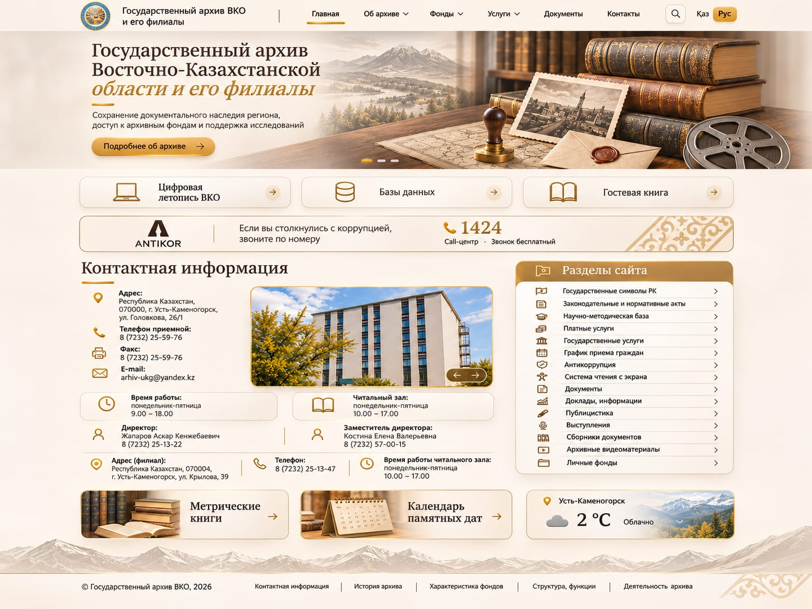
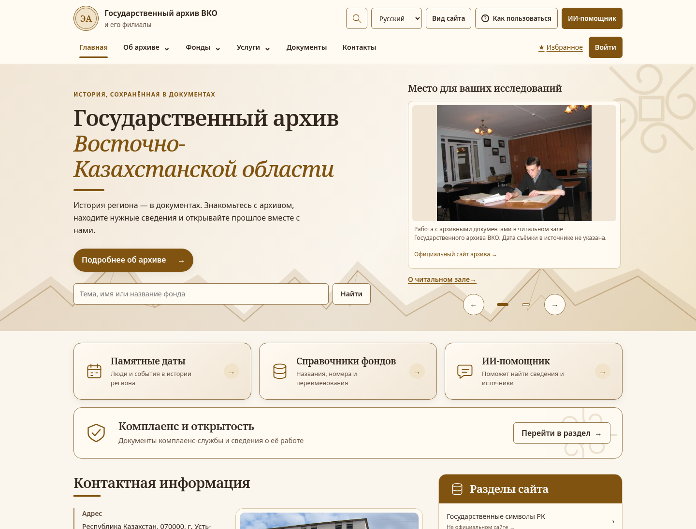
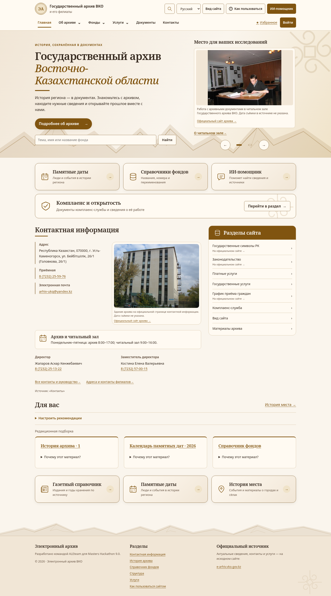

# Галерея дизайна по референсу

[Итог и границы проверки](../README.md). Все снимки — настоящая production-сборка с предоставленным корпусом, без фиктивных карточек и статических копий CMS-фото.

| Референс пользователя | Реализация, верх страницы |
|---|---|
|  |  |

[Полная главная, светлая тема](home-desktop-light.png) · [Тёмная тема](home-desktop-dark.png) · [Мобильная, текст 150%](home-mobile150.png) · [Мобильное меню](mobile-menu.png) · [Без JavaScript](home-no-js.png).

[Настоящий масштаб 200%, ширина 360, текст 150%](home-360-light-zoom200-text150.png) · [Та же проверка в тёмной теме](home-360-dark-zoom200-text150.png).

[Общий поиск](catalog-desktop-light.png) · [Чтение материала](material-desktop-light.png) · [Календарь](calendar-desktop-light.png) · [Услуги](services-desktop-light.png) · [Комплаенс](compliance-desktop-light.png) · [Фондовый справочник](fund-list-desktop-light.png).

[Видео пользовательских путей, 40 секунд](walkthrough.webm).

Доказательства: [432 обычные компоновки](ui-matrix.json) и [432 с настоящим zoom](native-zoom.json), [финальная главная](home-recheck.json) и [zoom главной](native-home-recheck.json), [8 сценариев](interactions.json), [72 axe-экрана](axe.json), [Lighthouse — все 18 попыток](performance.json), [сводка](validation.json).

Оригинальная композиция расширена для читаемого текста, источников фотографий и существующих рекомендаций. Не перенесены недоказанные номера/часы, чужие эмблемы, стоковый коллаж и несуществующие разделы. Подробные причины — в итоговом отчёте. Учётные данные, приватные профили и журналы сюда не включены.

[Главная на казахском](home-kk.png) · [Главная на английском](home-en.png) · [Мобильная тёмная тема, текст 150%](home-mobile-dark150.png).
