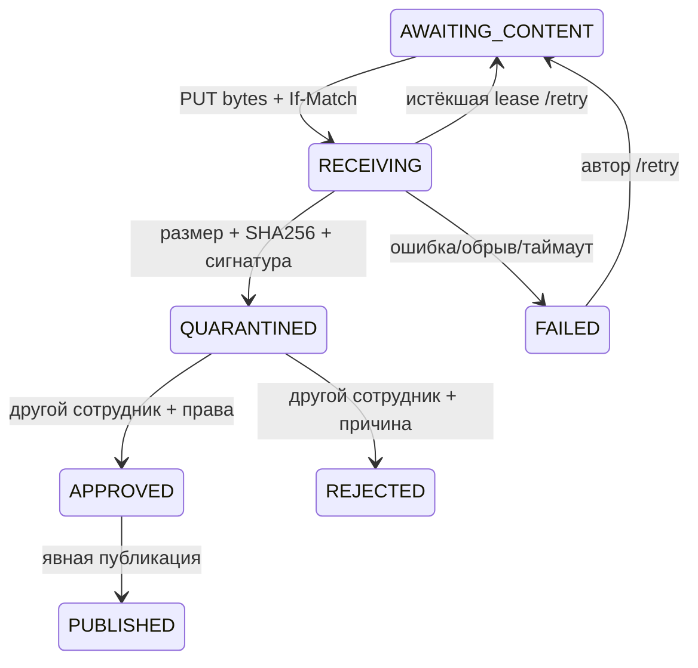

# Новые файлы: защищённый основной путь B07 / R-A03

Нужны миграция `202611100001_archive_uploads`, `npm run db:generate` и обычный `FILE_STORAGE_ROOT`. Дополнительные пакеты/внешние сервисы не требуются. Старые ArchiveFile/сканы/ID и закрытые копии сохраняются. Это **основной API-путь PDF/PNG/JPEG**, не завершение всех требований к TIFF/медиа/превью и фоновому распознаванию.

## Авторизация и состояние

Все пути `/api/admin/uploads` требуют активной сотруднической сессии и обычной same-origin проверки для изменений. Чтение — `catalog.read`, создание/передача/повтор — `catalog.write` в филиале документа. Бинарное содержимое меняет только исходный uploader, включая случай чужой загрузки у администратора. Проверка — `content.review` **и** `catalog.read`; публикация — `content.publish` **и** `catalog.read`. Автор не одобряет собственный файл даже при наличии права проверки. Аналитик/посетитель не получают эти полномочия. Текущая роль и область перечитываются при каждом запросе.



Запись состояния сохраняется в PostgreSQL. Проверки байтов выполняются в запросе, отдельный фоновый конвертер пока не добавлен. Срок загрузки — 30 секунд, восстановление RECEIVING через 120 секунд без обновления. Это техническая lease, не срок хранения архивных материалов. Попытки имеют уникальные объекты и токены: старый приёмник не может заменить новый файл после восстановления. Успешный повтор PUT с прежней версией не создаёт второй файл.

## Контракты

Браузерный [DTO](../../src/contracts/uploads.ts). В ответах нет storageKey, receiveToken или автоматически раскрытого вложенного Document/private notes. Uploader/reviewer и причины доступны лишь сотрудникам в разрешённой области; они не входят в публичную карточку/байты.

1. `POST /admin/uploads`:

```json
{
  "documentId": "ID",
  "originalName": "Original.png",
  "mimeType": "image/png",
  "expectedBytes": 12345,
  "expectedSha256": "64 lowercase hexadecimal characters computed from the actual file",
  "rights": "Права на конкретный файл",
  "sourceNote": "Происхождение конкретного файла"
}
```

Размер/хеш в примере — схема, не значения существующего файла. Ответ 201 `{item}` в AWAITING_CONTENT. Имя без каталогов/управляющих знаков, расширение соответствует MIME; подпись файла, точный размер и хеш вычисляются сервером отдельно. Пути, URL загрузки, uploaderId, status/isPublic и неизвестные поля во входе запрещены. До передачи байтов не создаётся публичный ArchiveFile.

2. `PUT /admin/uploads/:id/content` — исходные байты, Content-Type выбранного MIME, заголовок `If-Match: "<item.updatedAt ISO>"` с кавычками. Content-Length, если передан, должен совпадать; для chunked-потока всё равно считается реальный объём. Максимум **20 MiB**, точное совпадение с декларацией. Лимит срабатывает во время чтения; проверяются фактическая сигнатура и SHA-256. Успех `{item}` QUARANTINED. Файл хранится под созданным сервером случайным ключом с правами 0600, исходное имя не определяет путь. Мастер не перезаписывается. Внешние URL/объекты не загружаются.

3. `GET /admin/uploads/:id/content` — приватное получение для проверки в QUARANTINED/APPROVED/REJECTED/PUBLISHED. Hash/размер/сигнатура проверяются повторно; ответ attachment, sandbox, nosniff, private/no-store. Неавторизованный доступ запрещён; случайно угаданный `/files/upload-<id>` до отдельной публикации даёт 404.

4. `POST /admin/uploads/:id/review`:

```json
{"expectedUpdatedAt":"ISO","decision":"APPROVE","rightsConfirmed":true,"reason":"Основание проверки"}
```

APPROVE/REJECT, другая личность, обязательная причина. Для APPROVE нужно rightsConfirmed=true и повторная сверка сохранённых байтов. Чекбокс фиксирует решение сотрудника, не доказывает юридические права автоматически. REJECT не публикует и не удаляет мастер. Необходимость новой проверки при изменении содержимого обходить нельзя: одобренные байты неизменяемы, другая версия создаётся новой загрузкой.

5. `POST /admin/uploads/:id/publish` `{expectedUpdatedAt:"ISO",downloadable:false}`. Отдельное действие издателя только после APPROVED. Карточка уже должна быть опубликована, её филиал открыт и allowDigitalCopy=true. Создание ArchiveFile/связь с проверенной загрузкой/статус PUBLISHED/аудит — одна транзакция. Скачать через `?download=1` разрешается только при явном downloadable=true; по умолчанию false. Как и у прежнего просмотрщика, доступ к отображаемым публичным байтам не является технической защитой от сохранения пользователем.

6. `POST /admin/uploads/:id/retry` `{expectedUpdatedAt:"ISO"}` — только исходный автор, FAILED или истёкший RECEIVING. Заявленные MIME/размер/SHA остаются прежними. Отказ человека REJECTED не снимается повтором; нужен новый материал/решение, а не смена флага.

7. `GET /admin/uploads?documentId=ID&state=QUARANTINED&page=1&pageSize=20` и `GET /admin/uploads/:id` — фактические состояния/ошибки для интерфейса. Список фильтруется по областям; переданный чужой ID не расширяет права.

Конфликт/неверное состояние — 409 STALE_UPLOAD; ошибка MIME/хеша/размера — 400/413/415 с фиксированным кодом, без приватного пути/содержимого в логе. После сбоя приёма состояние FAILED и причина из фиксированного набора. Создание/приём/проверка/повтор/публикация ограничены rate-limit и записываются в аудит без байтов/секретов/приватной причины в общем журнале. Квоты прототипа: 100 активных загрузок автора и 1 GiB **заявленного** объёма неопубликованных записей; это не измерение свободного диска.

## Публичные ограничения и целостность

Новый файл становится публичным только через общий `fileResponse`, с проверкой актуальных прав карточки/филиала, отметки публикации файла и его одобренного SHA-256. Изменение сохранённого PNG на другой PNG той же длины после ревью тоже даёт 404. Отзыв allowDigitalCopy, публикации документа или видимости филиала закрывает уже связанный файл при следующем запросе. Частная проверка сотрудником — отдельный защищённый путь. Внешняя LLM не получает байты.

Сигнатура/размер/хеш — **не полный разбор формата и не антивирус**. Это явно указано в inspection DTO, чтобы сотрудник видел реальные проверки. TIFF, многостраничные производные, видео/аудио, AV/полный парсер, генерация превью и OCR новых ID остаются отдельным этапом; старый статический OCR не называется распознаванием любой загрузки. Первичный файл сохраняется без перекодирования; производные этим этапом не создаются. Завершённые неудачные попытки очищают собственные временные объекты; hard-crash может оставить `.part`, для них нужен операторский осмотр/регламент, автоматическое уничтожение архивных файлов не вводится.

## Воспроизведение и передача Алинуру

`npm test`, `npm run typecheck`, `npm run i18n:check`, `npm run build`, затем `npm run test:uploads` на собственной `_test` БД. Набор использует реальные собственные PNG и генерируемый проектом PDF, настоящие сессии/роли/филиалы и API. Проверяются self-approval, закрытая копия/скрытый филиал, отзыв роли, подмена байтов после публикации, конфликты PUT, восстановление lease с реальным ещё открытым старым потоком, квота, отсутствие лишних DTO-полей/осиротевших завершённых попыток и аудит. JPEG поддержан по сигнатуре; полная декодировка JPEG этим набором не заявляется.

R-F04: вычислить SHA-256 выбранного File, создать запись, передать байты с If-Match, показывать действительное состояние и фиксированные ошибки; отдельные кнопки проверки/подтверждения прав/публикации со стороны разрешённых ролей. Нельзя писать «опубликовано» после одного PUT. Для неподдерживаемого формата нужен честный отказ, до реализации конвертера. Все кнопки сопровождаются серверными отказами; их скрытие не считается защитой.
